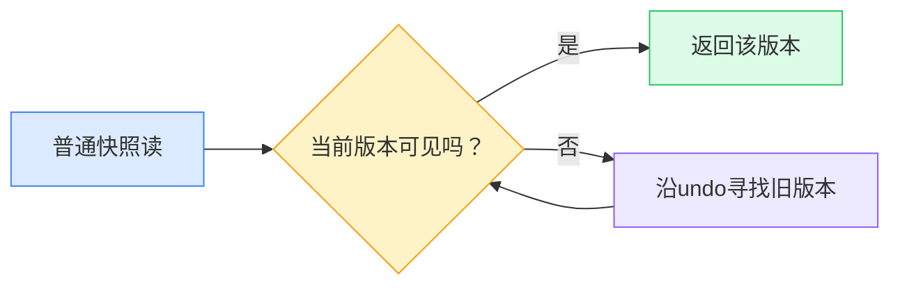

# 使用示例：从知识讲解到模拟面试

本例根据一次实际学习会话归纳改写，删去了重复解释和追问，并按当前技能规则整理；不是逐字聊天记录，也不是独立验收报告。示例中的题库编号属于原学习项目，新项目应使用自己的题库编号。每段问答代表独立一轮：先提问，等待用户回答，再反馈。

## 你可以怎样使用

| 你的输入 | 技能提供的帮助 |
|---|---|
| “今日学习开始，先学技术八股。” | 读取已有进度，接续学习，避免重复安排已完成的热身 |
| 发送知识截图：“帮我理解MVCC。” | 提炼重点，用生活类比、图解和小例子讲解 |
| 回答理解题 | 给参考答案，定位误区，必要时缩小问题纠错 |
| “根据记录和题库模拟技术面试。” | 在已学范围内逐题提问，按回答追问 |
| “今天复习结束。” | 保存实际表现，展示累计掌握和下次复习安排 |

已有项目会读取学习目录中的约定、进度和题库；首次使用可先说明学习目录、求职技术栈和算法语言。截图用于讲解，不自动等于要求入库。

## 1. 接续学习：从已有记录出发

**用户：** 今日学习开始，我先开始技术八股学习。

**助手：** 记录里你今天已经完成一轮复习，这次直接进入八股学习。你可以发主题、原文或截图，我会一次讲清一个知识点。

**体现的能力：** 以共享记录接续进度，不把建议任务记成已完成，也不假设掌握其他聊天的全部内容。

## 2. 图解讲解：把材料转成能理解的概念

**用户：** 发送“MVCC实现原理”的截图。

**助手：** MVCC让事务读取适合自己的数据版本。可以把它想成协作文档：别人修改时，你仍能查看历史版本。隐藏字段标识版本，undo帮助找到旧版本，Read View判断版本是否可见。



**助手提问：** 余额100元已提交。你创建Read View后，另一个事务改成80元并提交。自己没有修改数据，继续使用旧Read View做普通快照读，会读到多少？为什么？（根据本次内容自编）

到这里等待回答，不提前展示答案。

## 3. 纠错与检查：保留首答，不把提示后答对当作独立掌握

**用户首答（归纳）：** 80元，因为已经提交了。

**助手：** 应读到100元。旧Read View看的是创建时的可见范围，后来提交不会更新它。就像当时记下的名单，不会因为事情后来变化而自动改写。

| 评估 | 依据 | 后续 |
|---|---|---|
| 🔴 未掌握当前考点 | 混淆当前已提交与旧快照可见 | 缩小问题检查 |

**助手追问：** 如果事务已经提交，此时才创建新的Read View，它还会出现在这份“活跃且未提交”的事务名单里吗？

**用户：** 不会。

**助手：** 正确。创建新Read View时它已提交，不在活跃未提交名单中。本轮纠错后答对，记录为🟡待巩固，次日再独立复测。

**体现的能力：** 先给正确答案与理由，再围绕卡点追问；记录首答和纠错后的表现，不反复追问到绿色为止。

## 4. 模拟面试：从题库抽题，按实际回答推进

**用户：** 根据学习记录和外挂题库，模拟技术面试官向我提问。

**助手：** 本轮默认准备5道主问题，一次一道；纠错追问归入原题，你也可以指定题数或提前结束。先检查已学的索引知识。InnoDB表的id是主键，name有二级索引idx_name。下面查询使用idx_name，只考虑获取所需字段，需要回表吗？为什么？（改编自本例项目题库DB-003）

```sql
SELECT id FROM users WHERE name = '张三';
```

**用户：** 需要，根据索引再去查主键。

**助手：** 不需要。二级索引已经包含name和主键id，能直接返回id，这属于覆盖索引。若改为查询不在该索引中的age，需要回表吗？

**用户：** 需要，先从二级索引找到主键，再根据主键查年龄。

**助手：** 正确。通过主键查聚簇索引中的完整记录取得age，就是回表。本题由首答错误更新为纠错后答对，仍待独立复测。

本示例仅节选计划中的前两道主问题，不展示完整五题。接着转向下一知识点：

**助手：** 联合索引为(a,b)，把`WHERE a=1 AND b=2`改成`WHERE b=2 AND a=1`，仅交换书写顺序会使索引不可用吗？（题库DB-004）

**用户：** 不会，优化器会处理。

**助手：** 正确。查询优化器能分析这些等价条件；最左前缀关注索引列顺序，不是WHERE条件书写顺序。实际是否选用该索引仍取决于成本。本考点独立答对，记为🟢，本轮不再追问同一考点。

外部面经先核验再使用，不把未经确认的题目包装成真实公司原题；没有合适题目时可自编并注明来源。

## 5. 收尾与沉淀：让下一次学习有据可接

**用户：** 今天复习到此结束。

**助手（实际保存成功后）：** 本轮进度已保存。模拟面试计划的5道主问题完成了2道，其余3道因你提前结束而未完成，不计入掌握；前面的MVCC讲解检查单独记录。

| 今日考点 | 最终状态 | 下次安排 |
|---|---|---|
| MVCC旧快照可见性 | 🟡 纠错后理解 | 次日独立复测 |
| 覆盖索引与回表 | 🟡 首答错误，追问答对 | 次日复测 |
| 联合索引条件书写顺序 | 🟢 独立答对 | 3天后复习 |

累计概览结合此前记录展示：已有答题依据的LEFT JOIN、CLOSE_WAIT等列为绿色；本次MVCC与覆盖索引列为待巩固；未作答的RC问题仍为待验证。不会把一个小考点答对扩展成整章掌握。

**助手：** 今天你把卡点从判断错误推进到了能说明原因，这样的纠错很有价值。好好休息。

收尾后不再追加测验。复习日期按用户时区落为具体日期；没有提供时长，就不推测学习分钟数。

### 保存了什么

| 记录 | 用途 |
|---|---|
| `study_log` | 实际学了什么、完成情况、卡点和下一步 |
| `review_sessions` | 本次题干、来源或题库ID、原回答、参考答案与评估 |
| `review_items` | 当前掌握程度、判断依据、最近与下次复习日期 |

这些数据保存在用户学习目录的`learning-progress.json`，追加更新并保留历史，写入后验证可解析。示例内容不会自动写入使用者的个人学习记录。
